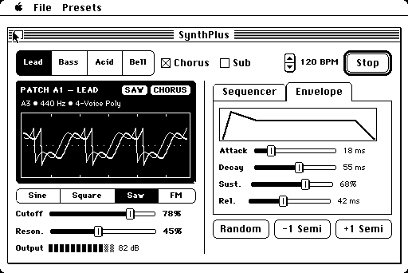
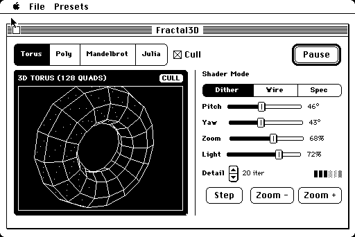

# SwiftUI68k — Declarative Swift 6.4 on a Macintosh Plus

A pair of intentionally playful, over-the-top single-file toy apps built to demonstrate our **`SwiftUI68k`** declarative UI framework and custom **Swift 6.4 (`swift68k`)** toolchain in action on a **1986 Macintosh Plus** (8 MHz Motorola 68000, 4 MB RAM, System 6.0.8, 512×342 1-bit screen, **no FPU**).

> **Why a synthesizer and a 3D/fractal renderer on a 1986 Mac Plus?**
> These are deliberately silly, "show-off" toy examples—not serious productivity software. Their sole purpose is to exercise **every widget and reactive update path of `SwiftUI68k`** (`VStack`, `HStack`, `Card`, `TabView`, `List`, `SegmentedPicker`, `Slider`, `Stepper`, `LevelMeter`, `Toggle`, `Button`, `Badge`, `Canvas`, `Timer`, and batched dirty-bit redraws) inside a single readable Swift 6.4 file.

---

## 1. [`SynthPlus`](Examples/SynthPlus/) — Toy 1-Bit Synthesizer, Oscilloscope & 8-Step Sequencer

A playful synthesizer and 8-step sequencer split cleanly into declarative UI ([`SynthPlusView.swift`](Examples/SynthPlus/SynthPlusView.swift)) and audio/DSP backend ([`SynthEngine.swift`](Examples/SynthPlus/SynthEngine.swift)) to put every `SwiftUI68k` control through its paces simultaneously: a `Timer`-driven `List` sequencer, a live `224 × 82` CRT oscilloscope (`Card(.dark)` + `Canvas` + `Badge`), `SegmentedPicker`s, live `Slider`s, a 12-segment `LevelMeter`, classic Mac push `Button`s and `Toggle` checkboxes, a `TabView` (`Sequencer` | `Envelope`), and real-time 11.1 kHz PCM synthesis via the Macintosh Sound Manager (`SndPlay`).

<p align="center">
  
</p>

```swift
struct SynthPlusView: View {
    var body: some View {
        VStack(spacing: 6, alignment: .leading) {
            HStack(.fit, spacing: 6) {
                SegmentedPicker(selection: Binding(&gPreset)) {
                    Text("Lead"); Text("Bass"); Text("Acid"); Text("Bell")
                }
                Toggle("Chorus", isOn: Binding(ptr: &gChorus))
                Toggle("Sub",    isOn: Binding(ptr: &gSub))
                Spacer()
                Stepper(value: Binding(&gBPM), in: 60...180, step: 4)
                NumberText(gBPM, suffix: " BPM").font(.bundledGeneva(9).bold())
                Button(gPlaying != 0 ? "Stop" : "Play", tag: kTagPlay).defaultButton()
            }

            HStack(.fit, spacing: 10) {
                VStack(spacing: 6, alignment: .leading) {
                    Card(.dark, padding: 6, spacing: 4) {
                        HStack(.fit, spacing: 4) {
                            Text(presetTitle(gPreset)).font(.bundledGeneva(9).bold())
                            Spacer()
                            Badge(waveBadge(gWave))
                            if gChorus != 0 { Badge("CHORUS") } else if gSub != 0 { Badge("SUB") }
                        }
                        Text(presetSubtitle(gPreset)).font(.bundledGeneva(9))
                        Canvas(224, 82, key: scopeKey, draw: drawOscilloscope)
                    }

                    SegmentedPicker(selection: Binding(&gWave)) {
                        Text("Sine"); Text("Square"); Text("Saw"); Text("FM")
                    }

                    HStack(.fit, spacing: 6) {
                        Text("Cutoff").font(.bundledGeneva(9).bold())
                        Slider(value: Binding(&gCutoff), in: 0...100, live: true, width: 138)
                        NumberText(gCutoff, suffix: "%").font(.bundledGeneva(9).bold())
                    }
                    HStack(.fit, spacing: 6) {
                        Text("Reson.").font(.bundledGeneva(9).bold())
                        Slider(value: Binding(&gReso), in: 0...100, live: true, width: 138)
                        NumberText(gReso, suffix: "%").font(.bundledGeneva(9).bold())
                    }
                    HStack(.fit, spacing: 6) {
                        Text("Output").font(.bundledGeneva(9).bold())
                        LevelMeter(value: gVU, segments: 12)
                        NumberText(gVU, suffix: " dB").font(.bundledGeneva(9))
                    }
                }
                Divider()
                VStack(spacing: 6, alignment: .leading) {
                    TabView(selection: Binding(&gTab)) {
                        Tab("Sequencer") {
                            List(rowCount: 8, rowHeight: 17, selection: Binding(&gStepSel),
                                 rows: 8, key: UInt32(bitPattern: gPreset), row: drawStepRow)
                        }
                        Tab("Envelope") {
                            EnvelopeView()
                        }
                    }
                    HStack(.equal, spacing: 6) {
                        Button("Random",  tag: kTagRand)
                        Button("-1 Semi", tag: kTagSemiDown)
                        Button("+1 Semi", tag: kTagSemiUp)
                    }
                }
            }
        }
    }
}
```

---

## 2. [`Fractal3D`](Examples/Fractal3D/) — Toy 1-Bit 3D & Fixed-Point Fractal Explorer

Another intentionally over-the-top demo split into declarative UI ([`Fractal3DView.swift`](Examples/Fractal3D/Fractal3DView.swift)) and fixed-point 3D/fractal backend ([`FractalEngine.swift`](Examples/Fractal3D/FractalEngine.swift)) to showcase `SwiftUI68k`'s reactive `Slider`s, `SegmentedPicker`s, `Toggle`s, `Stepper`, `LevelMeter`, and keyed `Canvas` redraws on an 8 MHz 68000 with **no FPU**:
- **Q8.8 Fixed-Point 3D Engine ([`FractalEngine.swift`](Examples/Fractal3D/FractalEngine.swift))**: 64-entry integer sine/cosine table, 3-axis perspective projection, 2D screen-space normal backface culling, and depth-based 1-bit stipple shading (**3D Torus** and **Compound Octahedron + Cube**).
- **Q4.12 Fixed-Point Fractal Engine ([`FractalEngine.swift`](Examples/Fractal3D/FractalEngine.swift))**: Pure integer **Mandelbrot Set** and **Julia Set** ($z_{n+1} = z_n^2 + c$) rendered onto a `244 × 180` 1-bit viewport using a `4×4` **Bayer ordered dithering matrix**.

<p align="center">
  
</p>

```swift
struct Fractal3DView: View {
    var viewKey: UInt32 {
        UInt32(bitPattern: (gScene << 24) ^ (gShadeMode << 20) ^ (gPitch << 12) ^ (gYaw << 6) ^ gZoom ^ (gLight << 3) ^ (gIter << 1) ^ gCull)
    }

    var body: some View {
        VStack(spacing: 6, alignment: .leading) {
            HStack(.fit, spacing: 6) {
                SegmentedPicker(selection: Binding(&gScene)) {
                    Text("Torus"); Text("Poly"); Text("Mandelbrot"); Text("Julia")
                }
                Toggle("Cull", isOn: Binding(ptr: &gCull))
                Spacer()
                Button(gSpin != 0 ? "Pause" : "Animate", tag: kTagSpin).defaultButton()
            }

            HStack(.fit, spacing: 10) {
                Card(.dark, padding: 6, spacing: 4) {
                    HStack(.fit, spacing: 4) {
                        Text(sceneTitle(gScene)).font(.bundledGeneva(9).bold())
                        Spacer()
                        Badge(sceneBadge(gScene))
                    }
                    Canvas(244, 180, key: viewKey, draw: drawViewport)
                }
                Divider()
                VStack(spacing: 7, alignment: .leading) {
                    Text("Shader Mode").font(.bundledGeneva(9).bold())
                    SegmentedPicker(selection: Binding(&gShadeMode)) {
                        Text("Dither"); Text("Wire"); Text("Spec")
                    }
                    HStack(.fit, spacing: 6) {
                        Text("Pitch").font(.bundledGeneva(9).bold())
                        Slider(value: Binding(&gPitch), in: 0...100, live: true, width: 112)
                        NumberText(gPitch, suffix: "°").font(.bundledGeneva(9))
                    }
                    HStack(.fit, spacing: 6) {
                        Text("Yaw  ").font(.bundledGeneva(9).bold())
                        Slider(value: Binding(&gYaw), in: 0...100, live: true, width: 112)
                        NumberText(gYaw, suffix: "°").font(.bundledGeneva(9))
                    }
                    HStack(.fit, spacing: 6) {
                        Text("Zoom ").font(.bundledGeneva(9).bold())
                        Slider(value: Binding(&gZoom), in: 20...100, live: true, width: 112)
                        NumberText(gZoom, suffix: "%").font(.bundledGeneva(9))
                    }
                    HStack(.fit, spacing: 6) {
                        Text("Light").font(.bundledGeneva(9).bold())
                        Slider(value: Binding(&gLight), in: 0...100, live: true, width: 112)
                        NumberText(gLight, suffix: "%").font(.bundledGeneva(9))
                    }
                    HStack(.fit, spacing: 6) {
                        Text("Detail").font(.bundledGeneva(9).bold())
                        Stepper(value: Binding(&gIter), in: 8...32, step: 4)
                        NumberText(gIter, suffix: " iter").font(.bundledGeneva(9))
                        Spacer()
                        LevelMeter(value: gCpuLoad, segments: 6)
                    }
                    HStack(.equal, spacing: 6) {
                        Button("Step",   tag: kTagStep)
                        Button("Zoom -", tag: kTagZoomOut)
                        Button("Zoom +", tag: kTagZoomIn)
                    }
                }
            }
        }
    }
}
```

---

<sub>*Disclaimer: This is an independent project and is not affiliated with, endorsed by, or sponsored by Apple Inc. Apple, Macintosh, QuickDraw, Swift, and SwiftUI are trademarks of Apple Inc., registered in the U.S. and other countries.*</sub>
